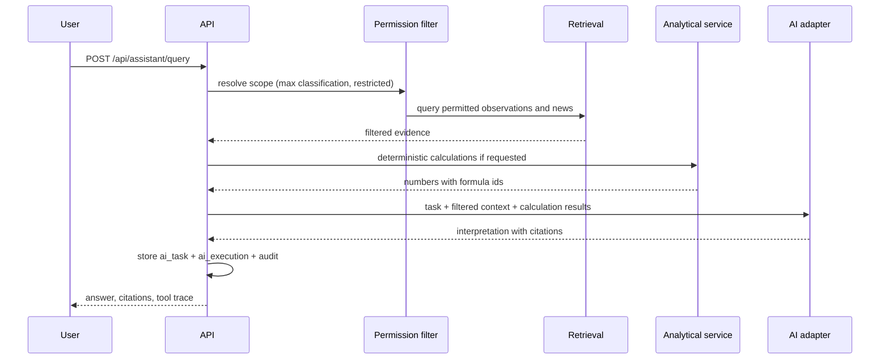
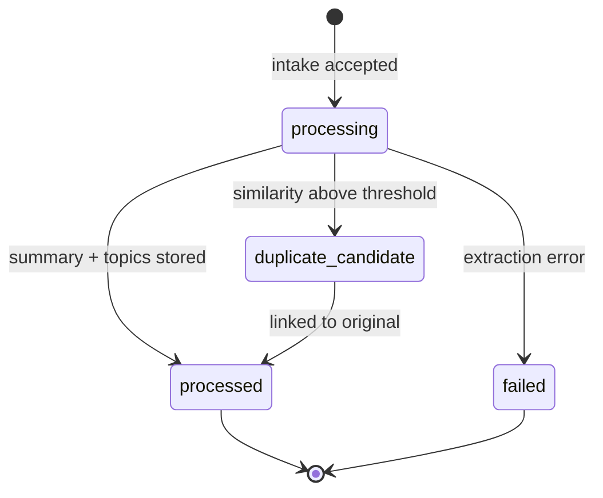

# API contract — BSR Market Intelligence

Base path: `/api`. JSON in, JSON out. The SPA is served from `/` and calls these routes with the session cookie.

## Conventions

- Success: `200` read, `201` created, `204` deleted.
- Errors: `400` malformed, `401` no/expired session, `403` authenticated but not permitted, `404` absent or hidden by permission, `405` method not allowed, `409` conflict, `413` body too large, `422` validation, `429` rate limited, `500` unexpected.
- Error body: `{"error": {"code": "forbidden", "message": "…", "details": {…}}}`
- Every state-changing request (`POST`, `PUT`, `PATCH`, `DELETE`) requires header `X-CSRF-Token` matching the session's CSRF token; otherwise `403 csrf_failed`.
- Timestamps are ISO 8601 with offset. Money and prices are numbers; units are explicit strings.
- Permission filtering happens server-side before serialization. A hidden object returns `404`, never `403` with content.

## Auth

| Method | Route | Auth | Body / query | Response |
|---|---|---|---|---|
| POST | `/api/auth/session` | none | `{"role": "leadership"\|"mi"\|"internal"}` | `201 {"user": User, "csrf_token": "…"}`; sets `bsr_session` HttpOnly cookie |
| DELETE | `/api/auth/session` | session | — | `204`; invalidates the server-side session |
| GET | `/api/me` | session | — | `200 {"user": User, "csrf_token": "…"}` |

`User` = `{id, name, role, department, max_classification, can_view_restricted, can_export, is_admin}`.

Login is rate limited per client address (10 attempts / 5 minutes) and audited.

## Market data

| Method | Route | Auth | Notes |
|---|---|---|---|
| GET | `/api/overview` | session | Tape, metric cards, drivers, highlights, latest briefing, freshness |
| GET | `/api/instruments` | session | Permission-filtered catalog |
| GET | `/api/instruments/{id}` | session | Instrument + latest observation + formula (if calculated) |
| GET | `/api/instruments/{id}/series?range=7D\|1M\|3M\|6M\|1Y&compare={id}` | session | `{series: [{instrument, unit, points: [{t, v}]}], events: [...]}`; gaps are `null` values, never zero; events include source and linked instruments |
| GET | `/api/observations?instrument=&from=&to=&limit=` | session | Table rows with source, market/ingestion time, statuses |
| POST | `/api/observations` | MI | Manual observation; `201`; audited |
| GET | `/api/formulas` | session | Formula catalog with version and inputs |
| POST | `/api/calculations/crack` | session | `{"formula_id": "CS-GAS-2.1", "as_of": "…"}` → `201 {value, unit, formula, inputs, calculated_at}`; `422 mixed_price_types` when disallowed |

`POST /api/observations` body: `{instrument_id, value, unit, market_time, source_id, data_status, quality_status, classification}`. Validation: instrument exists, unit matches the instrument, value finite, market_time not in the future by more than 5 minutes, classification at or below the user's maximum.

## News

| Method | Route | Auth | Notes |
|---|---|---|---|
| GET | `/api/news?topic=&source=&from=&to=&status=&q=` | session | Permission-filtered feed; restricted rows absent entirely |
| GET | `/api/news/{id}` | session | Original, summary, insight, topics, linked instruments, duplicate link, feedback |
| POST | `/api/news` | MI | Text intake; `201`; processing simulated synchronously; audited |
| POST | `/api/news/upload` | MI | `multipart/form-data` field `file`; allowed `.csv .xlsx .pdf .doc .docx`, max 5 MB; `413` oversized, `422 unsupported_type`; nothing stored on failure |
| POST | `/api/news/{id}/feedback` | session | `{"kind": "important"\|"comment", "body": "…"}`; `201` |
| GET | `/api/news/coverage?event_id=` | session | Source comparison: shared topics, unique details, counts (never a trust score) |

## Forecasts

| Method | Route | Auth | Notes |
|---|---|---|---|
| GET | `/api/forecasts?instrument=&source=&horizon=` | session | Current version per forecast series |
| GET | `/api/forecasts/{id}/versions` | session | Immutable version history |
| POST | `/api/forecasts/{id}/versions` | MI | New version; `201`; previous versions unchanged |
| GET | `/api/forecasts/evaluation?instrument=&horizon=` | session | Absolute/percentage error, MAE, MAPE, bias; missing actuals stated, not zero |

## Analysis and AI

| Method | Route | Auth | Notes |
|---|---|---|---|
| GET | `/api/analysis?question=` | session | Deterministic facts, calculations, assumptions, recommendation, evidence ledger; computed on demand and not persisted |
| POST | `/api/assistant/query` | session | `{"question": "…"}` → `201 {answer, citations, tool_trace, execution}`; rate limited 20 / 5 min per user |
| GET | `/api/briefings` | session | Briefing versions, newest first |
| POST | `/api/briefings` | MI | Regenerate; `201` new version, prior versions unchanged |
| GET | `/api/ai/executions` | admin | Execution table |

Assistant flow:

The AI adapter never receives a record the user cannot read, and never computes a number the analytical service owns.

## Reports

| Method | Route | Auth | Notes |
|---|---|---|---|
| GET | `/api/reports` | session | Permission-filtered list |
| POST | `/api/reports` | session | `{"type", "range_start", "range_end"}` → `201` new version with frozen content and source ledger |
| GET | `/api/reports/{id}` | session | Report + versions + sources |
| GET | `/api/reports/{id}/export.pdf` | `can_export` | `200 application/pdf`; `403 export_denied` and an audit row when not permitted |

## Administration

| Method | Route | Auth | Notes |
|---|---|---|---|
| GET | `/api/admin/users` | admin | Role matrix |
| PATCH | `/api/admin/users/{id}` | admin | Change `max_classification`, `can_view_restricted`, `can_export`, `is_admin`; audited |
| GET | `/api/admin/sources` | admin | Source catalog |
| GET | `/api/admin/audit?action=&actor=&from=&to=` | admin | Append-only audit log |
| GET | `/api/admin/ai-executions` | admin | AI execution table (alias: `GET /api/ai/executions`) |

## Global

| Method | Route | Auth | Notes |
|---|---|---|---|
| GET | `/api/search?q=` | session | Permission-scoped instruments, news, reports |
| GET | `/api/notifications` | session | User + broadcast notifications |
| POST | `/api/notifications/{id}/read` | session | `204` |
| GET | `/api/health` | none | `200 {"status": "ok", "db": "ok"}` |

## News processing state machine

A duplicate candidate keeps its own row and links `duplicate_of`; the original is never deleted.

## Security obligations

- Session cookie: `HttpOnly`, `SameSite=Lax`, `Secure` when the request is HTTPS, `Path=/`.
- CSRF: double-submit token, compared in constant time.
- Body size: global cap 6 MB at the WSGI boundary; upload cap 5 MB; `413` before parsing.
- Rate limits: login 10/5 min per address, assistant 20/5 min per user, upload 10/5 min per user, export 10/5 min per user. Counters update atomically in SQLite.
- Authorization is checked in the service layer for every read and write, including AI retrieval and PDF export.
- Audit rows for: sign-in, sign-out, restricted view, manual observation, news intake, upload, AI request, report generation, export attempt (allowed or denied), permission change.

## Critical Files for Implementation

- `app/api/__init__.py` — blueprint registration and the route table above.
- `app/api/auth_routes.py` — session, CSRF and login rate limiting.
- `app/api/market_routes.py` — overview, series, observations, calculations.
- `app/api/assistant_routes.py` — permission-scoped retrieval and execution records.
- `app/api/report_routes.py` — generation, versions and the export gate.
