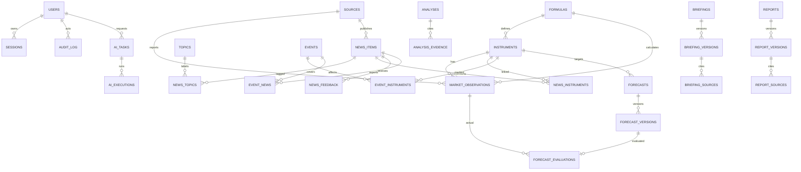

# Data model — BSR Market Intelligence

Status: decided. SQLite, 3NF, foreign keys enforced. Entity names follow `docs/design/specs/CONTEXT.md`.

## Entity relationships

The diagram is split by concern in the tables below; it is an overview, not a complete column map.

## Access-control vocabulary

- `classification` is one of `public`, `internal`, `confidential`, `restricted`; rank order is exactly that.
- A user may read a row when `rank(row.classification) <= rank(user.max_classification)`.
- `restricted` physical observations additionally require `users.can_view_restricted = 1`.
- Export requires `users.can_export = 1`; administration requires `users.is_admin = 1`.
- Every table that stores business content carries `classification`; derived rows inherit the highest classification of their inputs.

## Tables

### Identity and access

**users** — demo accounts, one per role.

| Column | Type | Constraints |
|---|---|---|
| id | TEXT | PK |
| name | TEXT | NOT NULL |
| role | TEXT | NOT NULL, CHECK in (`leadership`,`mi`,`internal`) |
| department | TEXT | NOT NULL |
| max_classification | TEXT | NOT NULL, CHECK in (`public`,`internal`,`confidential`,`restricted`) |
| can_view_restricted | INTEGER | NOT NULL DEFAULT 0 |
| can_export | INTEGER | NOT NULL DEFAULT 0 |
| is_admin | INTEGER | NOT NULL DEFAULT 0 |
| created_at | TEXT | NOT NULL (ISO 8601) |

**sessions** — server-side session records; the cookie carries only the opaque token.

| Column | Type | Constraints |
|---|---|---|
| token_hash | TEXT | PK (SHA-256 of the cookie value) |
| user_id | TEXT | NOT NULL, FK users(id) ON DELETE CASCADE |
| csrf_token | TEXT | NOT NULL |
| created_at | TEXT | NOT NULL |
| expires_at | TEXT | NOT NULL |
| last_seen_at | TEXT | NOT NULL |

Index: `sessions(user_id)`, `sessions(expires_at)`.

**rate_limits** — atomic counters for login, upload, assistant and export.

| Column | Type | Constraints |
|---|---|---|
| key | TEXT | PK (`<action>:<scope>:<window-start>`) — implemented as `limit_key` |
| count | INTEGER | NOT NULL DEFAULT 0 |
| window_start | TEXT | NOT NULL |
| expires_at | TEXT | NOT NULL |

### Market data

**sources** — every provider, internal feed or analytical origin.

| Column | Type | Constraints |
|---|---|---|
| id | TEXT | PK (`SRC-ICE`) |
| name | TEXT | NOT NULL |
| kind | TEXT | NOT NULL, CHECK in (`market`,`news`,`internal`,`analytical`) |
| classification | TEXT | NOT NULL |
| licence_note | TEXT | NULL |
| active | INTEGER | NOT NULL DEFAULT 1 |

**instruments** — tracked series.

| Column | Type | Constraints |
|---|---|---|
| id | TEXT | PK (`brent_futures`) |
| name | TEXT | NOT NULL |
| short_name | TEXT | NOT NULL |
| ticker | TEXT | NOT NULL |
| group_name | TEXT | NOT NULL |
| unit | TEXT | NOT NULL |
| price_type | TEXT | NOT NULL, CHECK in (`futures`,`physical`,`index`,`calculated`) |
| decimals | INTEGER | NOT NULL DEFAULT 2 |
| classification | TEXT | NOT NULL |
| description | TEXT | NULL |
| formula_id | TEXT | NULL, FK formulas(id) |
| display_order | INTEGER | NOT NULL DEFAULT 0 |

**formulas** — versioned, reproducible crack-spread definitions.

| Column | Type | Constraints |
|---|---|---|
| id | TEXT | PK (`CS-GAS-2.1`) |
| name | TEXT | NOT NULL |
| version | TEXT | NOT NULL |
| expression | TEXT | NOT NULL (human-readable rule) |
| input_instruments | TEXT | NOT NULL (JSON array of instrument ids) |
| allow_mixed_price_types | INTEGER | NOT NULL DEFAULT 0 |
| unit | TEXT | NOT NULL |
| created_at | TEXT | NOT NULL |
| active | INTEGER | NOT NULL DEFAULT 1 |

**market_observations** — one timestamped value from one source.

| Column | Type | Constraints |
|---|---|---|
| id | INTEGER | PK AUTOINCREMENT |
| instrument_id | TEXT | NOT NULL, FK instruments(id) |
| source_id | TEXT | NOT NULL, FK sources(id) |
| value | REAL | NOT NULL |
| unit | TEXT | NOT NULL |
| market_time | TEXT | NOT NULL (ISO 8601 with offset) |
| ingested_at | TEXT | NOT NULL |
| data_status | TEXT | NOT NULL, CHECK in (`real-time`,`delayed`,`eod`,`manual`) |
| quality_status | TEXT | NOT NULL, CHECK in (`valid`,`pending`,`rejected`,`corrected`) |
| classification | TEXT | NOT NULL |
| formula_id | TEXT | NULL, FK formulas(id) |
| calculation_inputs | TEXT | NULL (JSON array of observation ids) |
| calculated_at | TEXT | NULL |
| created_by | TEXT | NULL, FK users(id) |
| UNIQUE | | (instrument_id, source_id, market_time) |

Indexes: `(instrument_id, market_time DESC)`, `(classification)`, `(source_id)`.

### News and events

**news_items**

| Column | Type | Constraints |
|---|---|---|
| id | TEXT | PK (`N-2411`) |
| title | TEXT | NOT NULL |
| source_id | TEXT | NOT NULL, FK sources(id) |
| published_at | TEXT | NOT NULL |
| ingested_at | TEXT | NOT NULL |
| body | TEXT | NOT NULL |
| summary | TEXT | NULL |
| insight | TEXT | NULL |
| classification | TEXT | NOT NULL |
| processing_status | TEXT | NOT NULL, CHECK in (`processing`,`processed`,`duplicate_candidate`,`failed`) |
| relevance | INTEGER | NULL, CHECK 0–100 |
| duplicate_of | TEXT | NULL, FK news_items(id) |
| coverage_note | TEXT | NULL |
| created_by | TEXT | NULL, FK users(id) |
| created_at | TEXT | NOT NULL |

Indexes: `(published_at DESC)`, `(classification)`, `(processing_status)`, `(duplicate_of)`.

**topics** — `id` TEXT PK, `label` TEXT NOT NULL UNIQUE.
**news_topics** — `(news_id, topic_id)` composite PK, both FKs.
**news_instruments** — `(news_id, instrument_id)` composite PK, both FKs.
**news_feedback** — `id` INTEGER PK, `news_id` FK, `user_id` FK, `kind` CHECK in (`important`,`comment`), `body` TEXT NULL, `created_at` TEXT NOT NULL.

**events**

| Column | Type | Constraints |
|---|---|---|
| id | TEXT | PK |
| title | TEXT | NOT NULL |
| event_type | TEXT | NOT NULL |
| occurred_at | TEXT | NOT NULL |
| source_id | TEXT | NULL, FK sources(id) |
| status | TEXT | NOT NULL, CHECK in (`confirmed`,`developing`) |
| classification | TEXT | NOT NULL |

**event_instruments** — `(event_id, instrument_id)` composite PK.
**event_news** — `(event_id, news_id)` composite PK.

### Forecasts

**forecasts** — the series identity; values live in versions.

| Column | Type | Constraints |
|---|---|---|
| id | TEXT | PK (`F-101`) |
| instrument_id | TEXT | NOT NULL, FK instruments(id) |
| source_id | TEXT | NOT NULL, FK sources(id) |
| horizon | TEXT | NOT NULL |
| period | TEXT | NOT NULL |
| classification | TEXT | NOT NULL |
| created_at | TEXT | NOT NULL |

**forecast_versions** — immutable revisions.

| Column | Type | Constraints |
|---|---|---|
| id | INTEGER | PK AUTOINCREMENT |
| forecast_id | TEXT | NOT NULL, FK forecasts(id) |
| version | INTEGER | NOT NULL |
| value | REAL | NOT NULL |
| methodology | TEXT | NOT NULL |
| published_at | TEXT | NOT NULL |
| ingested_at | TEXT | NOT NULL |
| created_by | TEXT | NULL, FK users(id) |
| UNIQUE | | (forecast_id, version) |

**forecast_evaluations** — deterministic comparison with an actual observation.

| Column | Type | Constraints |
|---|---|---|
| id | INTEGER | PK AUTOINCREMENT |
| forecast_version_id | INTEGER | NOT NULL UNIQUE, FK forecast_versions(id) |
| actual_observation_id | INTEGER | NULL, FK market_observations(id) |
| absolute_error | REAL | NULL |
| percentage_error | REAL | NULL |
| note | TEXT | NULL (e.g. "actual missing") |
| evaluated_at | TEXT | NOT NULL |

### Analysis, briefings, reports

**analyses** — `id` TEXT PK, `question` TEXT NOT NULL, `as_of` TEXT NOT NULL, `status` CHECK in (`draft`,`published`), `version` INTEGER NOT NULL, `created_by` FK users, `created_at` TEXT NOT NULL. Unused in the MVP: `GET /api/analysis` is computed on demand and not persisted.

**analysis_evidence** — `id` INTEGER PK, `analysis_id` FK, `kind` CHECK in (`fact`,`calculation`,`assumption`,`recommendation`), `label` TEXT, `value` TEXT, `method` TEXT NULL, `source_ref` TEXT NULL, `position` INTEGER NOT NULL.

**briefings** — `id` TEXT PK, `title` TEXT NOT NULL, `created_at` TEXT NOT NULL, `classification` TEXT NOT NULL (highest classification ever generated; readers filter per version).

**briefing_versions** — `id` INTEGER PK, `briefing_id` FK, `version` INTEGER NOT NULL, `generated_at` TEXT NOT NULL, `data_cutoff` TEXT NOT NULL, `headline` TEXT NOT NULL, `moves` TEXT NOT NULL (JSON), `drivers` TEXT NOT NULL (JSON), `watchlist` TEXT NOT NULL (JSON), `ai_execution_id` INTEGER NULL, `classification` TEXT NOT NULL (derived from that version's cited inputs), UNIQUE(briefing_id, version).

**briefing_sources** — `id` INTEGER PK, `briefing_version_id` FK, `source_kind` TEXT, `source_id` TEXT, `label` TEXT, `position` INTEGER.

**reports** — `id` TEXT PK, `type` TEXT NOT NULL, `title` TEXT NOT NULL, `range_start` TEXT NOT NULL, `range_end` TEXT NOT NULL, `classification` TEXT NOT NULL, `created_by` FK users, `created_at` TEXT NOT NULL.

**report_versions** — `id` INTEGER PK, `report_id` FK, `version` INTEGER NOT NULL, `content` TEXT NOT NULL (JSON), `data_cutoff` TEXT NOT NULL, `requester_id` FK users, `created_at` TEXT NOT NULL, UNIQUE(report_id, version).

**report_sources** — `id` INTEGER PK, `report_version_id` FK, `source_kind` TEXT, `source_id` TEXT, `label` TEXT, `position` INTEGER.

### AI and audit

**ai_tasks** — `id` TEXT PK (`AI-8F2A`), `task_type` CHECK in (`market_briefing`,`news_summarization`,`chat_query`,`report_generation`,`analysis`), `user_id` FK users, `permission_scope` TEXT NOT NULL (JSON), `input` TEXT NOT NULL (JSON), `created_at` TEXT NOT NULL.

**ai_executions** — `id` INTEGER PK, `task_id` FK ai_tasks, `model` TEXT NOT NULL, `reasoning` TEXT NOT NULL, `tools_used` INTEGER NOT NULL, `latency_ms` INTEGER NOT NULL, `cost_usd` REAL NOT NULL, `status` CHECK in (`succeeded`,`fallback`,`failed`,`validation_failed`), `validation` TEXT NOT NULL, `output` TEXT NULL (JSON), `created_at` TEXT NOT NULL.

**audit_log** — append-only.

| Column | Type | Constraints |
|---|---|---|
| id | INTEGER | PK AUTOINCREMENT |
| actor_id | TEXT | NULL, FK users(id) |
| actor_role | TEXT | NULL |
| action | TEXT | NOT NULL |
| object_type | TEXT | NULL |
| object_id | TEXT | NULL |
| result | TEXT | NOT NULL |
| classification | TEXT | NULL |
| detail | TEXT | NULL |
| created_at | TEXT | NOT NULL |

Indexes: `(created_at DESC)`, `(actor_id)`, `(action)`.

**drivers** — `id` INTEGER PK, `group_name` CHECK in (`supply`,`demand`,`geopolitics`,`logistics`,`macro`), `label` TEXT, `detail` TEXT, `direction` TEXT, `strength` INTEGER, `as_of` TEXT, `classification` TEXT.

**notifications** — `id` INTEGER PK, `user_id` TEXT NULL FK users (NULL = broadcast), `title` TEXT, `body` TEXT, `route` TEXT, `created_at` TEXT, `read_at` TEXT NULL.

## Invariants

1. A forecast version is never updated or deleted; a correction inserts the next version.
2. A report version's `content` is frozen at generation; later source changes do not rewrite it.
3. A calculated observation stores `formula_id`, `calculation_inputs` and `calculated_at`; recomputation with the same inputs and formula version yields the same value.
4. A formula with `allow_mixed_price_types = 0` rejects inputs whose `price_type` differs.
5. `news_items.duplicate_of` links a candidate to its original; the original is never deleted.
6. `audit_log` rows are insert-only; no update or delete path exists in the application.
7. A restricted row is never serialized to a user without `can_view_restricted`; the filter runs before any response or AI context is built.

## Critical Files for Implementation

- `migrations/0001_init.sql` — every table, constraint and index above.
- `app/db.py` — connection, foreign keys, WAL, migration runner.
- `app/permissions.py` — classification rank and the row/field filter used by services.
- `app/services/market.py` — observation queries and the calculated-observation write path.
- `app/services/seed.py` — demo users, sources, instruments, observations, news, forecasts, reports.
